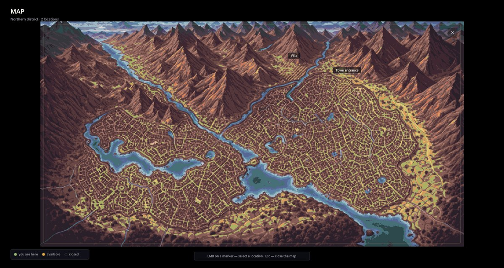
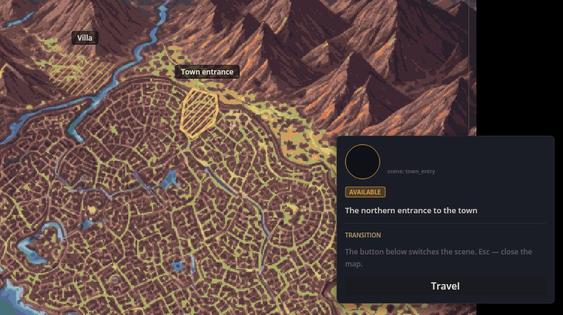
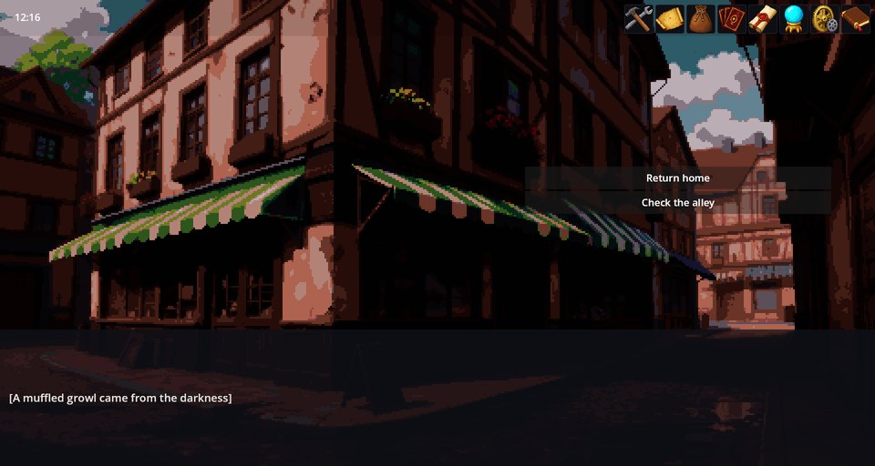

# World Map Engine——描いたマップの上を場所から場所へ

World Map Engine は、ゲーム世界を収めた全画面の絵に、場所を書き添えて表示します。プレイヤーはマップを開き、場所を選び、そこへ旅立ちます: ゲームはその場所のシーンへ切り替わります。シナリオは物語の進みに合わせて場所を開いたり閉じたり隠したり現したりでき、ゲームはその変化を保存します。

Cthangover が使っています。RPG World のタイルマップとは別物です: ワールドマップはクリックできる領域を持つ 1 枚の絵で、旅がシーンを切り替えます。タイルマップは、主人公が 1 マスずつ歩く格子です。

## ゲームの中でのマップ

ツールバーのマップアイコンで開きます。



- **場所**は絵の上に描かれた領域で、斜線で示されます。場所によっては、アイコン付きの丸いエンブレムも付きます。
- **凡例**: 緑 — 現在地、金色 — 行ける、灰色 — 閉鎖。
- **場所をクリック**すると、そのカードが出ます: 状態、説明、**移動** ボタン。**Esc** か **×** でマップを閉じます。



**移動** はゲームをその場所のシーンへ切り替えます:



場所が閉じている — カードには「道はまだ開いていません。」と出て、移動ボタンは現れない — のは、シナリオが閉じたとき、シーンを持たないとき、あるいはプレイしているゲームにそのシーンが存在しないときです。

## ゲームにワールドマップを追加する

ゲームは、その mod の中に 2 つのものを必要とします:

1. **絵** — `map` という名前の背景(例: `backgrounds/map.png`)。
2. **場所** — `map/` フォルダの JSON ファイル。位置はすべて絵の幅と高さに対する割合(0〜1)なので、マップはどんなサイズでも機能します。

これは Cthangover の町の入り口です(簡略版):

```json
{
  "Items": [
    {
      "ID": "town_entry",
      "points": [[0.7099, 0.2493], [0.7334, 0.2630], [0.7348, 0.2906], [0.7091, 0.3429], [0.6974, 0.3264]],
      "title": "",
      "scene": "town_entry",
      "description": "mapzone/town_entry/info",
      "locked": false,
      "hidden": false
    },
    {
      "ID": "town_entry_label",
      "points": [],
      "title": "mapzone/town_entry",
      "label_pos": [0.7246, 0.2163]
    }
  ]
}
```

- `points` — クリックできる領域の輪郭。
- `scene` — 移動が切り替える論理シーン。
- `title`、`description` — 翻訳キー。title は場所の名前で、カードとエンブレムに出ます。
- `image` と `image_pos` — アイコンとその位置。場所に丸いエンブレムを出すのに使います。
- `label_pos` — マップに独立して置かれる名前。title とラベル位置だけを持つゾーン(`town_entry_label` など)は名前であって場所ではないため、クリックできません。
- `locked` — 開始時に閉じています。`hidden` — 開始時に表示されません。

Cthangover は場所の名前を別のラベルゾーンに持ち、場所自身の `title` を空にしています。だから上のカードには上部に名前がないのです。

ワールドマップは、Editor Tools のマップエディターで描いて編集することもできます。

## シナリオから場所を変える

```scenario
action map.open_zone zone_id=town_entry
action map.close_zone zone_id=town_entry
action map.show_zone zone_id=town_entry
action map.hide_zone zone_id=town_entry
```

変化はセーブに記録され、ロード後も残ります。新しいゲームは JSON の値から始まります。

## うまくいかないとき

1. **「マップを表示できません」。** ゲームのどの mod にも `map` という名前の背景がありません。
2. **場所に入れない。** その `scene` が空か、つづりが間違っているか、シナリオが閉じています。
3. **場所の位置がおかしい。** 位置は絵に対する割合(0〜1)であり、ピクセルではありません。
